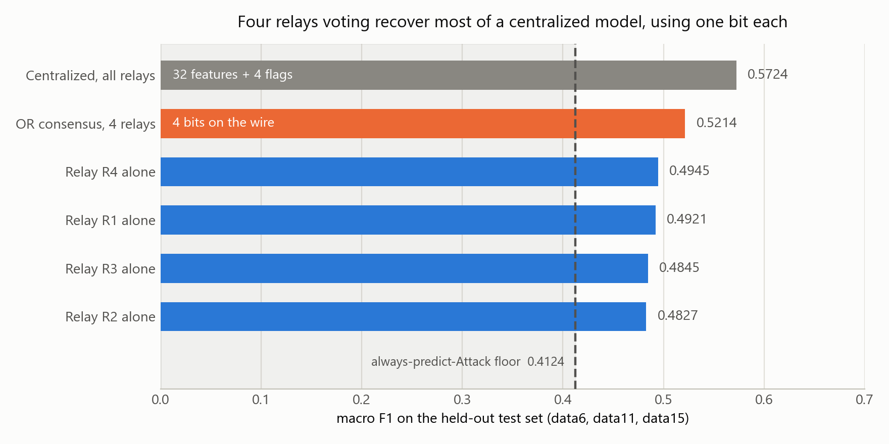
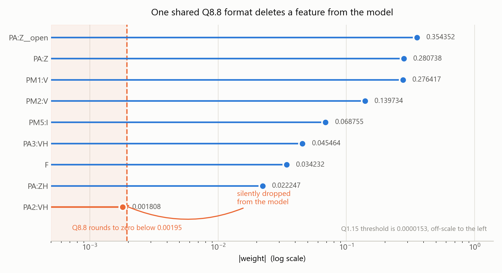

# Relay-Local Attack Detection for Power Grids on FPGA

A fixed-point logistic regression classifier that distinguishes cyber attacks from
natural faults on a power transmission system, implemented in FPGA fabric so that
each protective relay can classify its own measurements locally. Four relay-local
classifiers are combined with a one-bit consensus rule, which recovers most of the
accuracy of a centralized model while sending four bits across the network instead
of thirty-six measurements.

This extends a prior research project on the same dataset. That work asked what the
smallest set of PMU features is that a single relay could compute online at 120 Hz,
and whether a model trained on three relays generalizes to a fourth. The honest
answer was that a single relay does not have enough context for reliable detection,
and that grids would need multi-relay consensus. This project builds and measures
that consensus architecture in hardware.

## Problem

The dataset models a 3-bus, 2-line transmission system with four protective relays,
each containing a Phasor Measurement Unit sampling at 120 Hz. Distance relays trip
on apparent impedance, so an attacker who wants to cause a spurious trip spoofs
exactly that signal. The detection task is to separate genuine faults from injected
data using only what a relay can measure.

The constraint that makes this a hardware problem is the sample period. At 120 Hz a
relay has 8.33 ms between measurements, and any detection that cannot finish inside
that window is not usable for protection.

## Approach

Each relay runs an identical 9-input logistic regression over a reduced feature set:
eight PMU-derived features plus a binary flag marking an open breaker. Inference is
a dot product followed by a sign test, which is nine multiply-accumulates in
hardware. No sigmoid is required, since the sigmoid is monotonic and the decision
threshold maps to a sign test on the raw score.

Gradient boosting was evaluated as an alternative and rejected on measured grounds.
At full size it scores higher than logistic regression (0.5150 against 0.4732 macro
F1 under grouped cross-validation), but at a size that fits the fabric as
combinational logic (50 trees, depth 4) it drops to 0.4299, below the linear model.
The accuracy advantage of boosting is not available at deployable scale on this task.

## Results

All figures are macro F1. The floor is the always-predict-Attack baseline, which for
a class balance of p equals p / (1 + p).

### Held-out test set

Three recording sessions (data6, data11, data15) were held out by source file before
any model selection and scored once. 15,494 snapshots, attack rate 0.7018.

| Method | Accuracy | Precision | Recall | Macro F1 |
| --- | --- | --- | --- | --- |
| Any relay says Attack (OR, 4 bits) | 0.5614 | 0.7242 | 0.6058 | 0.5214 |
| Mean of relay scores | 0.5277 | 0.7303 | 0.5185 | 0.5080 |
| Majority vote, tie to Attack | 0.5201 | 0.7158 | 0.5243 | 0.4966 |
| Relay R4 alone | 0.5145 | 0.7176 | 0.5081 | 0.4945 |
| Relay R1 alone | 0.5128 | 0.7147 | 0.5090 | 0.4921 |
| Relay R3 alone | 0.4950 | 0.7230 | 0.4547 | 0.4845 |
| Relay R2 alone | 0.4932 | 0.7214 | 0.4525 | 0.4827 |
| Majority vote, tie to Natural | 0.4733 | 0.7171 | 0.4123 | 0.4674 |
| Unanimous Attack (AND) | 0.4606 | 0.7173 | 0.3820 | 0.4575 |
| Always Attack (floor) | 0.7018 | 0.7018 | 1.0000 | 0.4124 |

### Consensus against centralization

| Configuration | Inputs on the wire | Macro F1 | Gain over floor |
| --- | --- | --- | --- |
| Floor | none | 0.4124 | 0.0000 |
| Best single relay | 9 local features | 0.4945 | 0.0821 |
| OR consensus, 4 relays | 4 bits | 0.5214 | 0.1090 |
| Centralized, all relays | 32 features + 4 flags | 0.5724 | 0.1600 |

The OR consensus recovers 68.1 percent of the centralized model's gain over the
floor. The centralized model needs all thirty-two measurements plus four flags from
four relays at every snapshot. The consensus rule needs one bit per relay.

### Why OR and not majority vote

Requiring relays to agree makes detection worse, and the vote threshold sweep is
monotone in the held-out data:

| Relays that must say Attack | Macro F1 |
| --- | --- |
| 1 (OR) | 0.5214 |
| 2 (majority) | 0.4966 |
| 3 | 0.4674 |
| 4 (AND) | 0.4575 |

An attack on this topology is a local event. The relay nearest to it sees a clear
signature and the other three barely register it, so demanding confirmation discards
the signal. Majority vote gains essentially nothing over the best individual relay
(0.4966 against 0.4945). Lowering the bar to one relay is what works.

The combiner and vote threshold were selected on training data by sweeping all four
thresholds, then committed to this repository before the held-out set was scored. The
rule that won on training also won on the holdout, with the ranking of all nine
methods preserved except for a swap between R2 and R3.



**Figure 9.** Held-out macro F1 (data6, data11, data15) by detection architecture. OR
consensus across four relay-local classifiers recovers 68.1% of the centralized
model's gain over the always-predict-Attack floor, transmitting four bits per snapshot
rather than 32 feature values and 4 flags.

## Hardware architecture

```
  relay 1 features --> [ LR core 1 ] --+
  relay 2 features --> [ LR core 2 ] --+
                                       +--> OR --> attack / natural
  relay 3 features --> [ LR core 3 ] --+
  relay 4 features --> [ LR core 4 ] --+
```

Each LR core is a 9-input fixed-point dot product, a bias add, and a sign test,
producing one bit. The consensus layer is a single OR gate. Four cores and the gate
target one Zynq-7020 (Pynq-Z2).

The hardware and software boundary is drawn deliberately:

- Host (ARM processing system, Python): read features, cap `PA:Z` at the training
  quantile, derive the `PA:Z__open` flag, standardize to z-scores, quantize, and pack
  the DMA buffer.
- Fabric: four dot products, four sign tests, one OR gate.

Standardization and signal conditioning are fixed affine operations that in a real
relay would live in the analog front end, not in the classifier. Keeping them on the
host means the fabric implements the classifier and nothing else.

### Synthesis results

Vitis HLS 2024.1, target `xc7z020clg400-1`, 10 ns clock (100 MHz).

| Metric | Value | |
| --- | --- | --- |
| Latency | 46 cycles | 460 ns at 100 MHz |
| Latency variance | none | min equals max |
| Critical path | 6.082 ns | against a 10 ns target |
| LUT | 922 | 1.7% of 53,200 |
| FF | 1,242 | 1.2% of 106,400 |
| DSP | 36 | 16.4% of 220 |
| BRAM | 0 | |

Three things in that table are worth reading carefully.

**Latency is deterministic.** Minimum and maximum are both 46 cycles, so no input
makes the detector slower. A protection system needs a guaranteed worst case rather
than a good average, and this design has one by construction.

**36 of the 46 cycles are data movement.** The inner loop reports 36 cycles at an
initiation interval of 1, which is the 36 input words arriving one per clock. All 36
multiplies, the four comparisons, and the OR happen in roughly the remaining ten
cycles. The arithmetic is not the bottleneck and was never going to be.

**36 DSP slices is exactly 4 relays times 9 weights.** Every multiply is instantiated
in physical hardware and runs in parallel, which is what the `UNROLL` pragmas were
for. At 1.7% of the LUT fabric, four complete relay classifiers plus the consensus
gate occupy a small corner of a $200 board.

### Verification

| Stage | Result |
| --- | --- |
| C simulation | 100 / 100 snapshots matched |
| C/RTL co-simulation | PASS, 100 / 100 |
| Maximum stream depth observed | 36 |

Both stages use the same 100 test vectors, drawn from training files only and
stratified 50/50 by class. Expected outputs come from the fixed-point Python
reference in `python/lr_inference.py` rather than from the float model, so the pass
criterion is exact equality rather than a tolerance.

Exact agreement is achievable here by construction. The host quantizes, so the fabric
receives integers and performs no rounding at all: 16-bit multiplies accumulated into
a 40-bit register and compared against zero. Any disagreement between the Python
reference and the generated RTL would be a bug, not a rounding artifact.

The full report is in `docs/lr_consensus_csynth.rpt`.

**On interpreting the 460 ns.** That figure is the classifier alone. End-to-end
latency on hardware will also include the AXI DMA round trip and is expected to land
in the tens of microseconds. Both numbers are real and they measure different things,
so this README reports the classifier latency from synthesis and will report the
measured end-to-end figure separately once the design runs on the board.

## Evaluation protocol

Rows in this dataset are 99.92 percent autocorrelated in contiguous blocks, so a
random train/test split places near-duplicate neighbors on both sides and inflates
every metric. Published results on this dataset that use a random split are not
comparable to the numbers above.

Every figure here uses `StratifiedGroupKFold` grouped by source file, so an entire
recording session is either wholly in training or wholly in test. The held-out set is
three whole source files.

Feature selection was re-derived on the twelve training files alone, after the holdout
was carved out, using SHAP rankings averaged over five folds rather than a single
fold. Three features rank identically in all five folds (`PM2:V`, `PM1:V`, `PM5:I`).
Ranks six through ten are a statistical tie, so the tail of the selected set is not
stable and is reported as such.

## Design decisions

Each of the choices below was made against a measurement rather than a preference,
and in several cases the measurement overturned what I had originally planned to do.

**Logistic regression rather than gradient boosting.** The original intent was to
implement whichever model performed best, and under the grouped protocol that was
XGBoost at 0.5150 macro F1 against logistic regression's 0.4732. However, a 300-tree
ensemble at depth 6 comes to roughly 18,900 comparison nodes, which does not fit on a
Zynq-7020 as combinational logic. I therefore retrained XGBoost at a size that does
fit, 50 trees at depth 4, and evaluated it under the same grouped cross-validation on
the same twelve training files. It returned 0.4299, which is below the linear model
and only 0.013 above the always-predict-Attack floor. Specifically, this demonstrates
that the accuracy advantage of boosting on this task is not available at deployable
scale, so the relay-local classifier is logistic regression.

**Eight features rather than five.** The reduction curve puts the knee at k=8 by the
same within-1% rule used in the research phase, and k=5 misses that bar by 0.0051.
Since k=8 pulls `PA:Z` back into the feature set, it also reintroduces the infinity
policy and the `PA:Z__open` flag, giving nine model inputs instead of five. I kept
k=8 because the rule was fixed before the curve was run, and because preprocessing
happens on the host, where four additional inputs cost essentially nothing.

**Separate fixed-point formats for inputs and weights.** My starting plan specified
Q8.8, meaning eight integer and eight fractional bits for everything. However, once
the frozen coefficients were in front of me it became clear that one shared format
could not work, since the weights all sit inside plus or minus 0.355 while the
standardized inputs reach 85. Q8.8 resolves to 0.0039, and because a value rounds to
zero below half a step, any coefficient under 0.00195 disappears entirely. `PA2:VH`
is 0.001808. In other words, the format I started with would have silently deleted a
feature, and the hardware would have run perfectly while computing something other
than the model I validated. I split the two instead: `ap_fixed<16,8>` for inputs,
which covers the measured training range, and `ap_fixed<16,1>` for weights, which
holds every coefficient to within 0.44%.



**Figure 8.** Weight magnitudes against the rounding thresholds of two fixed-point
formats. A coefficient below half a quantization step rounds to zero. `PA2:VH` at
0.001808 falls below the Q8.8 threshold of 0.00195 and is eliminated; Q1.15 holds
every coefficient to within 0.44%.

**Input range measured on training data, not the holdout.** The first version of the
format sweep measured saturation against the held-out files, which top out at a
z-score of 13.4, and every candidate came back clean. The training files reach 85.5,
roughly six times further. Had I chosen the format from that sweep, real inputs would
have been clipped in deployment with nothing to indicate it. The sweep now measures
saturation against training z-scores, which is where a format decision belongs, and
the holdout only confirms afterward that nothing clips.

**The format that never clips over the one that scored higher.** Narrower integer
ranges actually scored slightly better, with `ap_fixed<16,5>` reaching 0.999806
consensus agreement against 0.998774 for the format I selected. That is not a
contradiction, since a narrower range buys fractional precision and the values that
get clipped sit far past the decision boundary anyway. However, those formats clip 42
real training values, and I hold that a claim requiring no caveat is worth more than
a thousandth of a point of agreement.

**OR consensus rather than majority vote.** Requiring relays to agree makes detection
worse, and the vote-threshold sweep is monotone across all four settings. An attack
on this topology is a local event, so the relay nearest to it registers a clear
signature while the other three barely see anything; demanding confirmation therefore
discards the signal rather than reinforcing it. Majority vote gains almost nothing
over the best individual relay, 0.4966 against 0.4945. The threshold was swept on
training data and committed to this repository before the held-out set was scored.

**Preprocessing on the host, classifier in the fabric.** Capping `PA:Z`, deriving the
open-breaker flag, standardizing to z-scores, and quantizing all happen on the ARM
processing system; the fabric does four dot products, four sign tests, and one OR.
Standardization is a fixed affine map that in a real relay would live in the analog
front end rather than in the detector, so this is not a shortcut, it is the correct
place to draw the line. It also means the fabric receives integers and performs no
rounding at all, which is what makes exact agreement between the Python reference and
the generated hardware achievable rather than approximate.

**A 40-bit accumulator.** The measured maximum across the held-out set needs 26 bits,
and the worst case with every input saturated works out to about 1.31e9, which needs
32 including the sign. Exact fit makes me uncomfortable and accumulator width is
close to free in fabric, so I declared 40 and verified roughly 19,800x headroom
against the observed maximum.

## Repository layout

```
notebooks/
  power_grid_classification.ipynb   original research: EDA, leakage analysis,
                                    feature importance, leave-one-relay-out
  model_exports.ipynb               feature re-derivation, consensus experiment,
                                    held-out evaluation, weight freeze
models/
  lr_weights.npz                    frozen coefficients, scaler parameters,
                                    PA:Z cap, feature order, vote threshold
  holdout_vectors.npz               held-out feature matrices and expected
                                    outputs, for hardware replay
python/
  lr_inference.py                   integer-only reference implementation
  test_lr.py                        pytest suite for the reference
  make_figures.py                   regenerates figures 8 and 9
hls/
  lr_consensus.cpp                  the kernel: 4 dot products plus an OR gate
  lr_weights.h                      generated from lr_weights.npz, not hand-edited
  lr_tb.cpp                         C testbench, exact-match pass criterion
  test_vectors.txt                  100 training snapshots, 50 per class
  run_hls.tcl                       csim, synthesis, cosim, IP export
figures/                            generated plots
data/
  power_system_combined.csv         not tracked, see Data below
```

## Data

Mississippi State University and Oak Ridge National Laboratory Power System Attack
Dataset, originally fifteen CSV files of roughly 5,000 rows each. The combined file is
78,377 rows by 130 columns and is not tracked in this repository because of its size.

Source: https://www.kaggle.com/datasets/bachirbarika/power-system/data

Concatenate the fifteen files from `binaryAllNaturalPlusNormalVsAttacks/` with a
`source_file` provenance column and save as `data/power_system_combined.csv`.

## Reproducing

```
pip install numpy pandas scikit-learn xgboost shap matplotlib pytest
jupyter lab notebooks/model_exports.ipynb
```

Run all cells in order. Every random seed is fixed at 42. The notebook asserts the
expected data shape, block structure, and group separation, so a mismatch fails
loudly rather than producing quietly wrong numbers.

## Project status

Complete:

- Model frozen and verified. The saved weights reproduce the scikit-learn decision
  function with a maximum error of 0.0 across all 61,976 held-out relay rows.
- Consensus architecture selected, pre-registered, and validated once on held-out data.
- Fixed-point formats selected from measured ranges, with the quantization cost of
  each candidate recorded.
- Integer-only reference implementation and a 12-test pytest suite.
- HLS kernel written, with its arithmetic verified against the reference in Python
  before compilation.
- Synthesized to the xc7z020 at 100 MHz: 460 ns deterministic latency, 1.7% LUT,
  16.4% DSP, no BRAM.
- C simulation and C/RTL co-simulation both passing 100 of 100 vectors.
- RTL exported as a Vivado IP catalog package.

In progress:

- Vivado block design, bitstream, and deployment to Pynq-Z2.
- Measured end-to-end latency on hardware.
- Hardware replay of the held-out set.

## Limitations

Absolute performance is low. The best configuration reaches 0.5214 macro F1 against a
floor of 0.4124. The finding is not that this detector is accurate. It is that
relay-local detection has an information ceiling that model capacity does not fix, and
that a one-bit consensus rule is the cheapest way found here to push past it.

Other limitations carried from the research phase: labels are system-level and
inherited by all four relay views, so a remote relay is labeled Attack for a
disturbance it may barely see. The infinity cap quantile of 0.999 was chosen rather
than tuned. Results come from a single testbed topology. No hyperparameter tuning was
performed, deliberately, since tuning under a leaky protocol optimizes for the leak.
